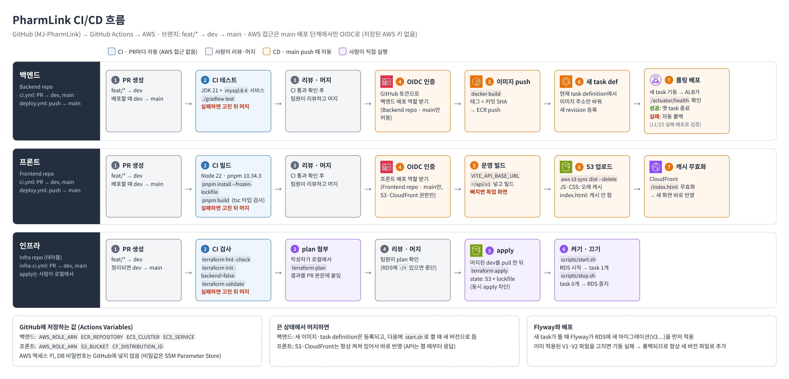

# PharmLink Infra

중소 제약 유통 ERP **PharmLink**를 AWS에 배포하는 인프라 코드(Terraform) 저장소입니다.
백엔드(Spring Boot)는 ECS Fargate, 프론트(React + Vite)는 S3 + CloudFront로 서비스합니다.

- 데모: https://d2bbn94lai6m55.cloudfront.net (비용을 줄이려고 백엔드와 DB는 시연·작업 시간에만 켭니다)
- 운영 기간: 2026.11.16 ~ 12.03 (이후 `terraform destroy`로 전체 삭제)
- 관련 저장소: [Backend](https://github.com/MJ-PharmLink/Backend) · [Frontend](https://github.com/MJ-PharmLink/Frontend)

## 구성도


## 한눈에 보기

| 항목 | 구성 |
|---|---|
| 리전 | 서울 `ap-northeast-2`, 가용 영역 2a · 2c |
| 네트워크 | VPC `10.0.0.0/16`, Public 서브넷 2개(ALB · Fargate), Private 서브넷 2개(RDS), NAT Gateway 없음 |
| 프론트 | S3(비공개) + CloudFront(OAC, HTTPS) |
| 백엔드 | ALB → ECS Fargate (0.5 vCPU / 1GB, task 1개), 이미지는 ECR |
| DB | RDS MySQL 8.4, db.t4g.micro, Single-AZ, gp3 20GB 암호화, 시간대 Asia/Seoul |
| 비밀값 | SSM Parameter Store SecureString |
| IaC | Terraform ≥ 1.11, AWS provider 6.x, 상태 파일은 S3 (`use_lockfile` 잠금) |
| CI/CD | GitHub Actions + OIDC (AWS 액세스 키 없음) |
| 모니터링 | CloudWatch 알람 8개 → SNS 메일, CloudTrail (전 리전) |
| 비용 관리 | AWS Budgets 월 $30 알림, `scripts/start.sh` · `stop.sh`로 ECS · RDS 켜고 끄기 |

## 요청 흐름

| 요청 흐름 | 설명 |
|---|---|
| 사용자 → CloudFront | HTTPS, 주소 하나로 화면과 API를 함께 제공 |
| `/` → S3 | 프론트 빌드 파일 (버킷은 비공개, CloudFront OAC로만 읽기) |
| `/api/*` → ALB → ECS Fargate | 백엔드 :8080, 캐시하지 않음, ALB 헬스체크 `/actuator/health` |
| ECS → RDS MySQL 8.4 | :3306, Private 서브넷, 인터넷 접근 없음 |

| 보안그룹 | 인바운드 허용 |
|---|---|
| ALB | CloudFront 관리형 prefix list → 80 |
| ECS | ALB 보안그룹 → 8080 |
| RDS | ECS 보안그룹 → 3306 |

## 보안 설계

| 대상 | 방법 |
|---|---|
| 프론트 파일 | S3 퍼블릭 접근을 모두 차단하고, CloudFront OAC로 서명된 요청만 읽게 합니다. 버킷 정책도 이 CloudFront 배포(ARN)로 제한합니다. |
| ALB | CloudFront에서 오는 요청만 받습니다 (prefix list). ALB 주소로 직접 들어오는 요청은 막힙니다. 잘못된 헤더는 버립니다 (`drop_invalid_header_fields`). |
| ECS | ALB 보안그룹에서 오는 8080만 받습니다. 퍼블릭 IP는 ECR 이미지와 SSM 값을 받아 오는 나가는 연결에만 씁니다. |
| DB | Private 서브넷, `publicly_accessible = false`, ECS 보안그룹에서 오는 3306만 받습니다. 저장소는 암호화합니다. |
| 비밀값 | JWT 시크릿, 관리자 계정, DB 비밀번호는 SSM SecureString에 두고 ECS task `secrets`로 주입합니다. 코드, 이미지, GitHub에는 없습니다. |
| DB 비밀번호 | Terraform `ephemeral random_password`로 만들고 write-only 속성(`password_wo`, `value_wo`)으로 넘겨 **state 파일에도 남지 않습니다**. |
| 배포 권한 | GitHub Actions OIDC로 1시간짜리 임시 자격 증명만 받습니다. 역할은 저장소별로 나눴습니다 (백엔드: ECR push · ECS 배포, 프론트: S3 업로드 · CloudFront 캐시 무효화). 신뢰 조건은 **main 브랜치 + 조직 · 저장소 고유 ID**로 고정했습니다. |
| 이미지 | ECR 태그는 덮어쓸 수 없고(IMMUTABLE, 커밋 SHA), push할 때 취약점을 스캔합니다. |
| 감사 | CloudTrail이 모든 리전의 관리 이벤트를 비공개 S3에 남기고, 로그 파일 무결성 검증을 켰습니다. |

## CI/CD



| 저장소 | 언제 | 무엇을 |
|---|---|---|
| Backend | PR → dev · main, dev push | `ci.yml`: MySQL 8.4 서비스 컨테이너로 `./gradlew test` |
| Backend | main push | `deploy.yml`: 테스트 → 이미지 빌드(태그 = 커밋 SHA 7자리) → ECR push → 최신 task definition에서 이미지만 교체 → ECS 서비스 업데이트 → 안정화까지 대기 |
| Frontend | PR → dev · main | `ci.yml`: `pnpm install --frozen-lockfile`, 빌드 검사 |
| Frontend | main push | `deploy.yml`: 빌드 → S3 업로드 (해시 파일 1년 캐시, `index.html`은 `no-cache`) → CloudFront 캐시 무효화 |
| Infra | PR → dev · main | `infra-ci.yml`: `terraform fmt` · `validate` (AWS에 접속하지 않음) |
| Infra | 머지 후 | `terraform plan`으로 바뀌는 내용을 확인한 뒤 `apply` (수동) |

## 무중단 배포와 자동 롤백

| ECS 서비스 설정 | 역할 |
|---|---|
| `deployment_minimum_healthy_percent = 100`, `maximum_percent = 200` | 새 task가 헬스체크를 통과한 뒤에 옛 task를 내립니다. 배포 중에도 task 1개가 계속 응답합니다. |
| `deployment_circuit_breaker { rollback = true }` | 새 task가 계속 실패하면 배포를 멈추고 직전 버전으로 되돌립니다. |
| `health_check_grace_period_seconds = 120` | Spring Boot가 뜨는 동안 헬스체크 실패로 task를 내리지 않습니다. |

**검증 (2026-11-25)**: ECR에 없는 이미지 태그로 일부러 배포했습니다.

| 시각 (KST) | 결과 |
|---|---|
| 10:23 | 실패용 task definition 배포 시작 |
| 10:24 ~ 10:35 | 새 task 3개가 이미지를 받지 못해 연속 실패 (`CannotPullContainerError`) |
| 10:40:01 | 회로 차단기 작동: `deployment failed` → `rolling back` |
| 10:40:31 | 직전 task definition으로 복귀 완료 (`deployment completed`) |
| 테스트 내내 | 기존 task가 계속 응답 (10초 간격 API 호출에서 5xx 0회) |

## 모니터링

**CloudWatch 알람 → SNS 메일**

| 알람 | 울리는 조건 |
|---|---|
| `alb-target-5xx` | 백엔드가 5분 동안 5xx를 5번 이상 응답 |
| `alb-elb-5xx` | ALB가 직접 502 · 503 · 504를 5분 동안 10번 이상 응답 (살아 있는 task 없음) |
| `alb-unhealthy-target` | 헬스체크에 실패한 task가 3분 넘게 있음 |
| `ecs-cpu-high` | 백엔드 CPU 평균 80% 이상이 15분 지속 |
| `ecs-memory-high` | 백엔드 메모리 평균 85% 이상이 15분 지속 |
| `rds-cpu-high` | DB CPU 평균 80% 이상이 15분 지속 |
| `rds-storage-low` | DB 남은 저장공간 2GB 미만 |
| `rds-memory-low` | DB 여유 메모리 50MB 미만이 15분 지속 |

- 꺼 둔 동안은 지표가 들어오지 않으므로 데이터 없음은 정상으로 봅니다 (`treat_missing_data = "notBreaching"`).
- 울릴 때와 정상으로 돌아올 때 모두 메일을 보냅니다.

**작업 기록과 로그**

- CloudTrail: 콘솔, CLI, Terraform, GitHub Actions의 AWS 작업을 모든 리전에서 기록해 S3에 90일 보관합니다.
- 백엔드 로그: CloudWatch Logs `/ecs/pharmlink-prod-backend` (7일 보관)

## 설계 결정

| 결정 | 이유 | 감수한 점 |
|---|---|---|
| NAT Gateway 없이 Fargate를 Public 서브넷에 둠 | NAT는 켜 두기만 해도 월 약 $43로 예산을 넘습니다. task는 퍼블릭 IP로 ECR · SSM에 직접 접근합니다. | Private 서브넷보다 노출 면이 넓어서, 보안그룹으로 ALB에서 오는 8080만 받습니다. |
| CloudFront 하나로 화면과 API 제공 (`/api/*` → ALB) | 도메인 없이 CloudFront 기본 인증서로 HTTPS를 쓰고, 같은 주소라 CORS 설정이 필요 없습니다. ALB는 CloudFront 뒤에 숨깁니다. | 인증서용 도메인이 없어 CloudFront → ALB 구간은 HTTP(80)입니다. ALB는 CloudFront prefix list로만 열었습니다. |
| RDS Single-AZ (2a) | 짧은 프로젝트 기간과 예산 기준으로 Multi-AZ(비용 2배)는 쓰지 않습니다. | 2a에 장애가 나면 DB가 멈춥니다. 자동 백업(1일)으로 복구합니다. |
| ECS · RDS를 작업 시간에만 켬 (`start.sh` · `stop.sh`) | 쓰는 시간에만 요금이 나가서 기간 전체 예상 비용이 약 $20입니다. | 켜는 데 약 10분 걸립니다 (RDS 기동). 중지한 RDS는 7일 뒤 자동으로 켜집니다. |
| Terraform write-only 비밀번호 | DB 비밀번호가 state 파일에 평문으로 남지 않습니다. | 비밀번호를 바꿀 때 `db_password_version`을 함께 올려야 합니다. |

## 폴더 구조

```
terraform/
├ versions.tf  providers.tf  variables.tf  locals.tf  outputs.tf   공통 설정 · 변수 · 출력값
├ network.tf  security_groups.tf  alb.tf  rds.tf                   네트워크 · ALB · DB
├ ecr.tf  ssm.tf  iam_ecs.tf  ecs.tf  cdn.tf                       백엔드 실행 · 프론트 배포
├ github_oidc.tf                                                   GitHub Actions 배포 역할
└ monitoring.tf  cloudtrail.tf                                     알람 메일 · 작업 기록
scripts/  start.sh  stop.sh                                        ECS task · RDS 켜고 끄기
docs/     architecture.png  architecture.drawio  cicd-flow.png     구성도(그림 · draw.io 원본) · CI/CD 흐름도
.github/workflows/infra-ci.yml                                     PR마다 fmt · validate
```

리소스 이름은 `pharmlink-prod-<용도>` 규칙을 따릅니다. `terraform.tfvars`와 `*.tfstate`는 git에 올리지 않습니다.
