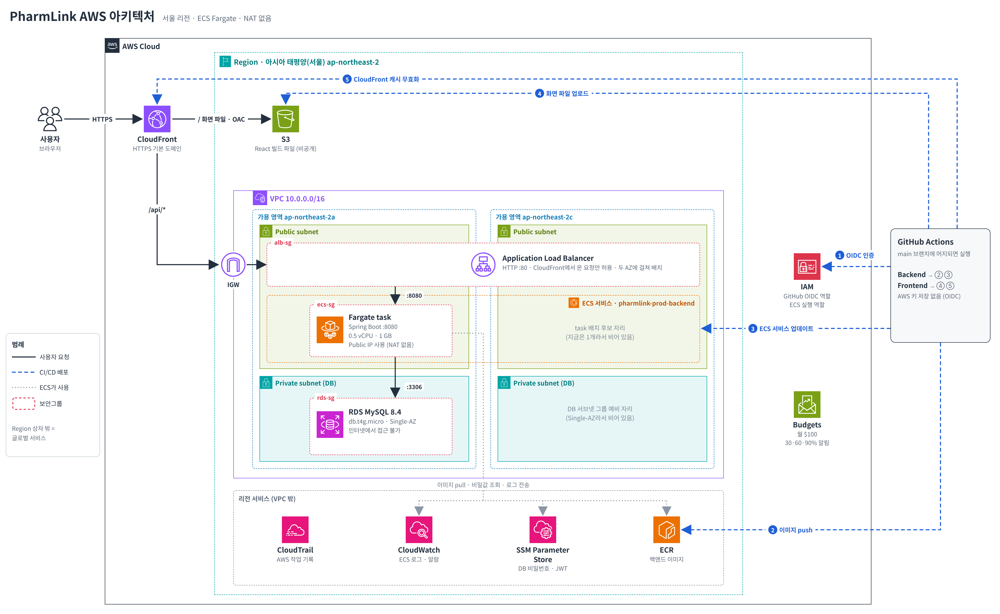

# PharmLink Infra

PharmLink(중소 제약 유통 ERP)의 AWS 인프라를 Terraform으로 관리하는 저장소입니다.
백엔드(Spring Boot)는 ECS Fargate, 프론트(React + Vite)는 S3 + CloudFront로 배포합니다.

- 리전: 서울 `ap-northeast-2`
- 관련 저장소: [Backend](https://github.com/MJ-PharmLink/Backend) · [Frontend](https://github.com/MJ-PharmLink/Frontend)

## 구성도



| 요청 흐름 | 설명 |
|---|---|
| 사용자 → CloudFront | HTTPS, 주소 하나로 화면과 API를 함께 제공 |
| `/` → S3 | 프론트 빌드 파일 (버킷은 비공개, CloudFront OAC로만 읽기) |
| `/api/*` → ALB → ECS Fargate | 백엔드 :8080, ALB 헬스체크 `/actuator/health` |
| ECS → RDS MySQL 8.4 | :3306, Private subnet, 인터넷 접근 없음 |

| 보안그룹 | 인바운드 허용 |
|---|---|
| ALB | CloudFront 관리형 prefix list → 80 |
| ECS | ALB 보안그룹 → 8080 |
| RDS | ECS 보안그룹 → 3306 |

정해진 예산으로 NAT Gateway는 쓰지 않습니다. Fargate task는 Public subnet에 두되, 보안그룹으로 ALB에서 오는 요청만 받습니다.

## 폴더 구조

```
terraform/
├ versions.tf  providers.tf  variables.tf  locals.tf  outputs.tf   
├ github_oidc.tf                                                   
├ network.tf  security_groups.tf  alb.tf  rds.tf                   
├ ecr.tf  ssm.tf  iam_ecs.tf  ecs.tf  cdn.tf                       
└ monitoring.tf                                                   
scripts/  start.sh  stop.sh     작업 시작·끝에 켜고 끄기
docs/     구성도, CI/CD 흐름도
```

리소스 이름은 `pharmlink-prod-<용도>` 규칙을 따르고, 같이 쓰는 값(포트, 헬스체크 경로, ECS·RDS 이름)은 `terraform/locals.tf`에 모아 둡니다.

## 준비

```bash
brew install awscli
brew tap hashicorp/tap && brew install hashicorp/tap/terraform
aws --version && terraform version
```

AWS 로그인은 IAM Identity Center(SSO)로 합니다. 액세스 키는 만들지 않습니다.

```bash
aws configure sso
#   SSO session name: pharmlink
#   SSO start URL: (IAM Identity Center의 AWS access portal URL)
#   SSO region: ap-northeast-2
#   계정 / AdministratorAccess 역할 선택
#   default region: ap-northeast-2, output: json, profile name: pharmlink

export AWS_PROFILE=pharmlink
aws sso login
aws sts get-caller-identity   # 계정 ID가 나오면 성공
```

```bash
git clone git@github.com:MJ-PharmLink/Infra.git
cd Infra
git switch dev
cd terraform
cp terraform.tfvars.example terraform.tfvars
terraform init
```

## 작업 규칙

1. `dev`에서 `feat/<작업>` 브랜치를 만들고, 담당 `.tf` 파일만 수정합니다.
2. push 전에 `terraform fmt -recursive`, `terraform validate`, `terraform plan`을 실행합니다.
3. PR 본문에 `terraform plan` 결과를 붙입니다. CI(`infra-ci`)는 fmt·validate만 검사하고 AWS에는 접속하지 않습니다.
4. 상대방이 plan을 확인하고 승인하면 머지합니다. RDS에 `-/+`(삭제 후 재생성)가 보이면 멈추고 같이 확인합니다.
5. **apply는 머지된 `dev`를 pull 한 뒤에만** 실행합니다. AWS 환경(prod)이 하나뿐이라 apply하는 브랜치도 `dev` 하나로 정합니다. 상태 파일 잠금(`use_lockfile`) 때문에 동시에 apply 하면 한쪽이 기다립니다.
6. 콘솔에서 Terraform이 만든 리소스를 직접 고치지 않습니다. 다음 plan이 되돌리려고 합니다.
7. `main`은 안정된 시점(발표 전 등)에 `dev` → `main` PR로 맞춥니다.

## 켜기·끄기

ALB, CloudFront, S3는 항상 켜 두고, 비용이 큰 ECS task와 RDS만 작업 시간에 켭니다.

```bash
./scripts/start.sh   # RDS 시작 → task 1개 (약 10분)
./scripts/stop.sh    # task 0개 → RDS 중지
```

중지한 RDS는 7일이 지나면 AWS가 자동으로 다시 켭니다. 12/3 이후에는 `terraform destroy`로 전부 삭제합니다.

## 비밀값

| 값 | 위치 |
|---|---|
| DB 비밀번호 | `rds.tf`의 `random_password`가 만들어 SSM Parameter Store에 저장 |
| JWT 시크릿, 관리자 계정 | `aws ssm put-parameter --type SecureString`으로 직접 입력 |
| GitHub Actions | AWS 키 없이 OIDC 역할 사용. 저장소 Variables에는 역할 ARN과 리소스 이름만 |

`terraform.tfvars`, `*.tfstate`는 git에 올리지 않습니다. 상태 파일에는 DB 비밀번호가 들어가므로 state 버킷은 비공개·암호화·버전 관리를 켜 둡니다.

## 비용 관리

- AWS Budgets: 월 $30, 실제 비용 50% · 80%와 예상 비용 100%에서 두 사람에게 메일 알림 (크레딧 제외)
- 예상 비용: 11/16 ~ 12/3, 평일 하루 2~3시간 사용 기준 약 $20 (ALB 상시 + task·RDS 사용 시간)

## CI/CD 흐름


